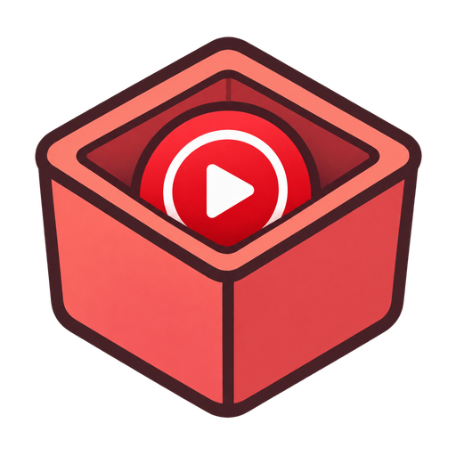
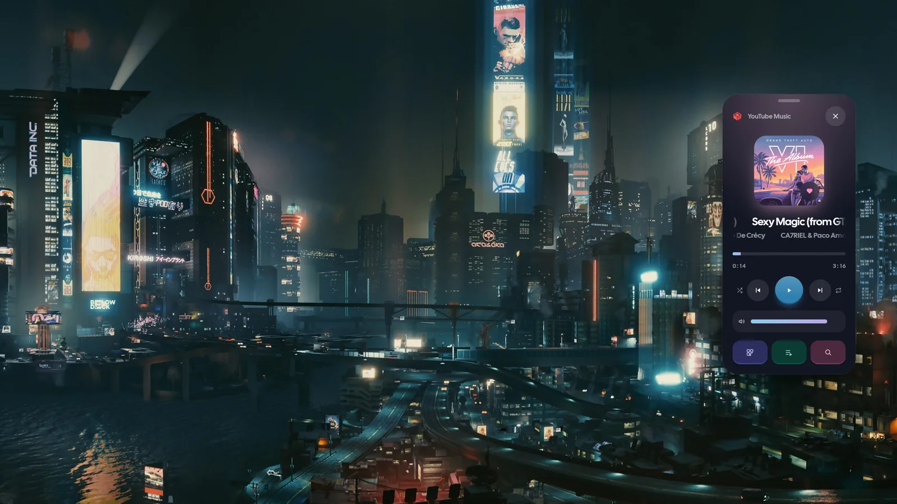
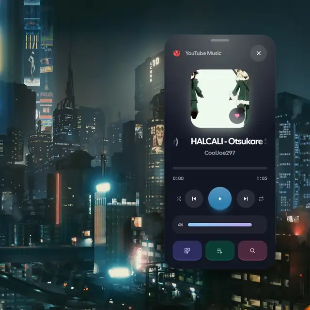
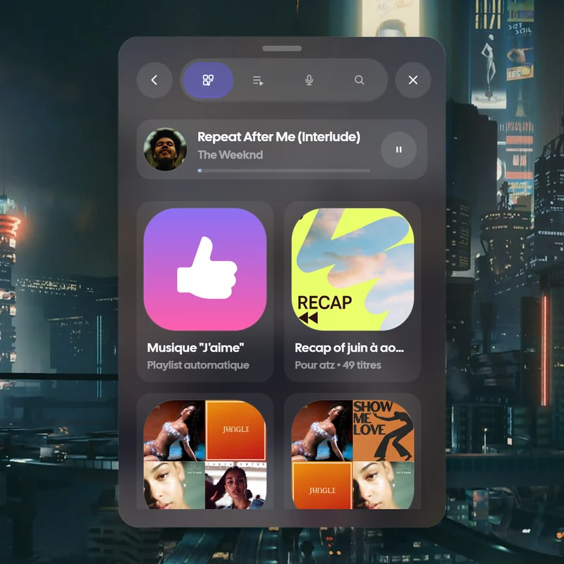
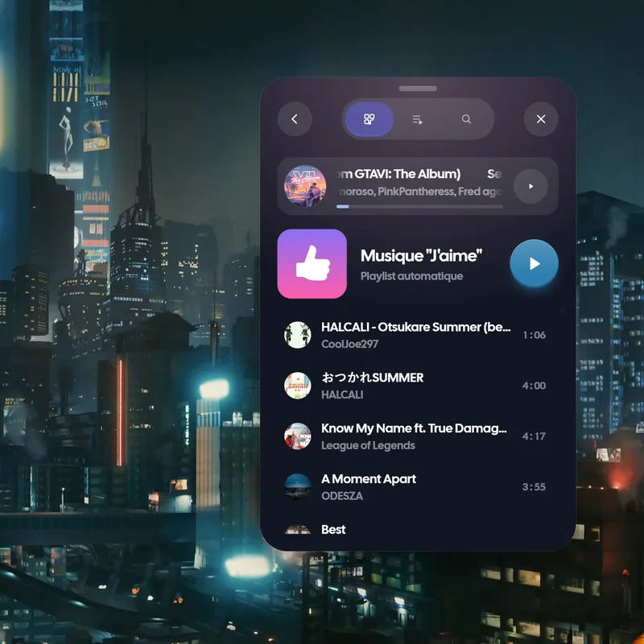
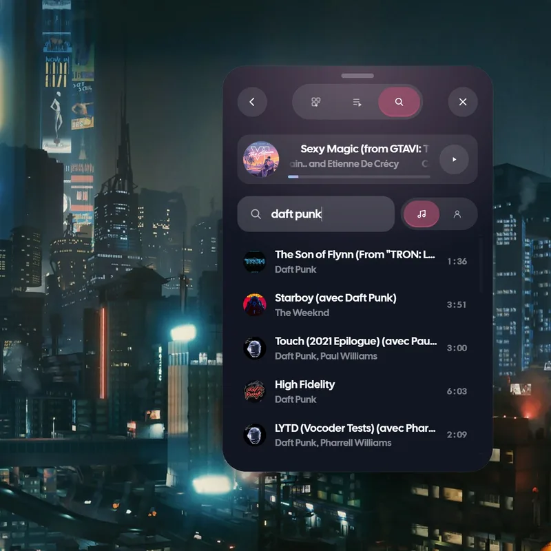

<div align="center">



# Music in the Box

### Votre musique, par-dessus votre jeu.

Pilotez YouTube Music, ou n'importe quel lecteur de musique Windows, sans quitter votre partie. Un raccourci, et un petit panneau de verre glisse par-dessus l'action ; encore une fois, et vous revoilà dans le combat.

<a href="https://github.com/atzski/ibox/releases/latest"><strong>Télécharger iBox</strong></a> · puis <strong>Paramètres › Plugins › Music in the Box</strong>

Windows 10 et 11 · Gratuit et open source · Un plugin pour <a href="https://github.com/atzski/ibox">iBox</a>

<sub><a href="README.md">English</a> · Français</sub>

<br>



</div>

## À ouvrir en pleine partie

**Alt+C** au clavier, ou **Vue + Y** maintenus à la manette. Le panneau prend la main tant qu'il est ouvert (le jeu ne reçoit plus vos commandes) et la rend dès qu'il se ferme. Le raccourci se change dans ses réglages, et iBox prévient si une autre application l'utilise déjà.

- **Clavier ou manette** : tout se fait avec les flèches et Entrée, ou la croix et A/B.
- **Un verre qui suit le jeu** : le panneau floute ce qu'il y a derrière lui, le jeu reste vivant sous le verre, et il prend les couleurs de la pochette.
- **Rester affiché** si vous voulez : le lecteur reste à l'écran pendant que le jeu garde le clavier et la manette.
- **Absent de vos captures** : le panneau est caché des captures d'écran et des clips, ceux d'iBox compris.

## Toute votre bibliothèque YouTube Music

<p align="center">
  
</p>

Connectez votre compte Google une fois, et le panneau vous donne votre bibliothèque : playlists et titres aimés, la file « À suivre », et la recherche par titre ou par artiste. Vos titres aimés s'affichent dès la première page, la suite arrive pendant que vous parcourez.

<p align="center">
  
  
  
</p>

Pas sur YouTube Music ? Le panneau pilote aussi ce qui passe par les contrôles média de Windows (Spotify, Deezer, un onglet de navigateur…) : titre, pochette, lecture/pause, précédent et suivant.

## Respect de la vie privée

YouTube Music tourne dans sa propre fenêtre isolée, avec son propre stockage. Vos cookies Google y restent : ni iBox ni le plugin ne les lisent. Cette fenêtre n'apparaît jamais dans la barre des tâches ; elle ne se montre que pour vous connecter.

Avant l'installation, iBox affiche exactement ce que le plugin pourra faire :

- afficher un panneau par-dessus vos jeux ;
- réserver un raccourci clavier (Alt+C par défaut) ;
- lire la manette pour ouvrir et piloter son panneau (Vue + Y) ;
- voir et piloter le lecteur de musique de Windows ;
- voir le jeu sous son panneau, pour l'effet de verre ;
- ouvrir music.youtube.com dans une fenêtre isolée.

Chaque paquet est signé par son éditeur, et iBox vérifie la signature avant toute installation. Un plugin désactivé ne réserve aucun raccourci et n'ouvre aucune fenêtre.

## Comment c'est fait

Le lecteur lui-même est intégré à iBox. Ce dépôt contient la partie qui change avec YouTube : le pont injecté dans music.youtube.com. Quand YouTube modifie ses pages, une nouvelle version du plugin corrige le pont, sans nouvelle version d'iBox.

| Dossier | Rôle |
|---|---|
| `bridge/` | Le pont : `parse.js` lit les réponses de YouTube Music (testé), `bridge.js` pilote le lecteur |
| `test/` | Tests Vitest, avec des réponses YouTube Music enregistrées (`fixtures/`) |
| `manifest.json` | Identité, permissions, panneau et WebView |

```
npm install
npm test
npm run pack      # paquet signé dans dist/ (la clé d'éditeur n'est jamais dans ce dépôt)
```

Pour essayer un paquet sans le publier : un catalogue local désigné par `IBOX_PLUGINS_CATALOG` au lancement d'iBox (voir `docs/PLUGINS.md` d'iBox).

<sub>Music in the Box n'est affilié ni à YouTube ni à Google. Créé par <a href="https://github.com/atzski">atzski</a>.</sub>
