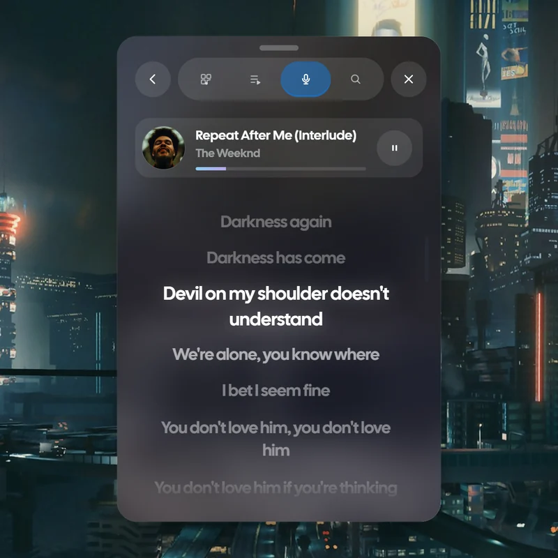

<div align="center">


# Music in the Box

### Your music, on top of your game.

Control YouTube Music, or any music player on Windows, without leaving your game. One shortcut and a small glass panel slides in over the action; press it again and you are back in the fight.

<a href="https://github.com/atzski/ibox/releases/latest"><strong>Get iBox</strong></a> · then <strong>Settings › Plugins › Music in the Box</strong>

<sub>No iBox? <a href="https://github.com/atzski/music-in-the-box/releases/latest">Download the standalone app</a> for Windows.</sub>

Windows 10 and 11 · Free and open source · A plugin for <a href="https://github.com/atzski/ibox">iBox</a>

<sub>English · <a href="README.fr.md">Français</a></sub>

<br>


</div>

## Open it in the middle of a game

Press **Alt+C** on the keyboard, or hold **View + Y** on a controller. The panel takes the focus while it is open, so your game no longer receives your inputs, and gives it back the moment you close it. The panel never steals a key your game uses: the shortcut can be changed in its settings, and iBox tells you if another app already holds it.

- **Keyboard or controller.** Everything works with the arrows and Enter, or with the D-pad and A/B.
- **Glass that follows the game.** The panel blurs what is behind it, so the game stays alive under the glass, and takes on the colours of the album cover.
- **Stay on screen** if you like: the player stays visible while the game keeps the keyboard and the controller.
- **Out of your captures.** The panel is hidden from screenshots and clips, including iBox's own.

## Your whole YouTube Music library

<p align="center">
  
</p>

Sign in once with your Google account and the panel gives you your library: your playlists and liked songs, what plays next, and search by song, video, artist or album. Your liked songs show up as soon as the first page arrives, and the rest loads while you scroll.

<p align="center">
  
  
  
</p>

- **Lyrics.** A fourth tab shows the words of the song that is playing; the text follows the song, and stops following as soon as you scroll it yourself.
- **Radio.** From "Up next", start a radio from the current song: similar songs, one after another, endlessly. An artist's big play button does the same from their most popular song.
- **Quick start.** When nothing is playing, the panel offers your liked songs and the last playlists and albums you started: one press and the music is on.
- **Seek without a mouse.** The progress bar can be reached with the arrows or the D-pad, in five-second steps. On the keyboard, X or Space plays and pauses, F likes the song.

Only YouTube Music is followed: a video playing elsewhere (Twitter, YouTube, a browser tab) never takes your music's place.

## Private by design

YouTube Music runs in its own isolated window, with its own storage. Your Google cookies stay in it: neither iBox nor the plugin ever reads them. That window never shows up in the taskbar; it only appears when you sign in.

Before installing, iBox lists exactly what the plugin is allowed to do:

- show a panel on top of your games;
- reserve a keyboard shortcut (Alt+C by default);
- read the controller to open and drive its panel (View + Y);
- see and control the Windows music player;
- see the game under its panel, for the glass effect;
- open music.youtube.com in an isolated window.

Every package is signed by its publisher, and iBox checks the signature before installing anything. A disabled plugin reserves no shortcut and opens no window.

## Without iBox: the standalone app

Don't use iBox? Music in the Box also exists as a small Windows app of its own: the same panel, the same YouTube Music bridge, nothing else around it.

1. Download `Music.in.the.Box_<version>_x64-setup.exe` from the [latest release](https://github.com/atzski/music-in-the-box/releases/latest) and run it (no administrator rights needed).
2. The app waits in the notification area. **Alt+C**, or **View + Y** held on a controller, opens the panel over your game; the same again closes it.
3. Click the tray icon for the settings: shortcut, where the panel sits on screen, staying visible while you play, YouTube Music sign-in, start with Windows, language.

The app speaks English, or French when Windows is in French; Settings › Language changes it. In iBox, the plugin follows the language of iBox.

If iBox runs with the plugin at the same time, both want Alt+C: pick another shortcut in one of them.

|  | iBox plugin | Standalone app |
|---|---|---|
| Install | iBox › Settings › Plugins | Installer from the Releases |
| Opens with | Alt+C, View + Y | Alt+C, View + Y |
| Lives in | iBox | The notification area |
| YouTube fixes | New plugin version, installed by iBox | New app version |

## How it is built

The player itself lives in iBox. This repository holds what changes with YouTube: the bridge injected into music.youtube.com. When YouTube changes its pages, a new plugin version fixes it, without a new iBox release.

| Folder | Role |
|---|---|
| `bridge/` | The bridge: `parse.js` reads YouTube Music's answers (tested), `bridge.js` drives the player |
| `test/` | Vitest tests, with recorded YouTube Music answers (`fixtures/`) |
| `manifest.json` | Identity, permissions, panel and web view |
| `app/` | The standalone app: interface (React 19) in `app/src`, native side (Tauri 2, Rust) in `app/src-tauri`; most of it comes from iBox |

```
npm install
npm test
npm run pack      # signed package in dist/ (the publisher key never lives in this repository)
```

The standalone app builds with Node, Rust and WebView2:

```
cd app
npm install
npm test
npx tauri build   # installer in app/src-tauri/target/release/bundle/nsis/
```

To try a package without publishing it, point iBox to a local catalog with `IBOX_PLUGINS_CATALOG` (see `docs/PLUGINS.md` in iBox).

<sub>Music in the Box is not affiliated with YouTube or Google. Made by <a href="https://github.com/atzski">atzski</a>.</sub>
